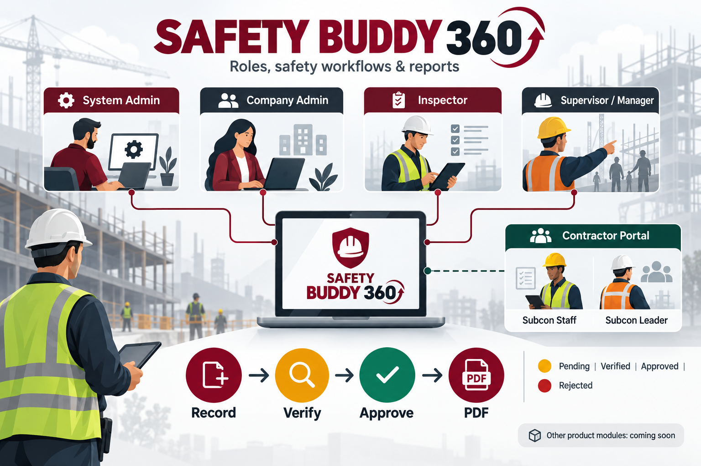

# Safety Buddy 360: roles, modules, statuses and PDF reports

This guide reflects the application routes, forms, models and PDF controllers as of 29 October 2026. “Module” has two meanings in the UI: the six product tiles on the module chooser, and the working areas inside the Safety (WSIS) product.

## 1. Product modules

| Product tile | Current role | Availability indicator |
| --- | --- | --- |
| Safety (`SB360-WSIS`) | Working safety management workspace described below | Active when subscribed; otherwise Expired or Locked |
| Products & Services (`SB360-PS`) | Preview tile; no working destination in the module chooser | Coming soon |
| Careers (`SB360-C`) | Preview tile | Coming soon |
| Training (`SB360-T`) | Preview tile | Coming soon |
| News (`SB360-N`) | Preview tile | Coming soon |
| Assist (`SB360-A`) | Preview tile | Coming soon |

The chooser has **4 possible indicators**: **Active**, **Expired**, **Locked**, **Coming soon**. These are access/availability states, not safety performance results. The current screen explicitly says Safety is available and the other products are previews.

## 2. Roles and permissions

| Role | What the role can do |
| --- | --- |
| System Admin (role 1) | View the system dashboard; create/update users; manage company subscriptions, packages and plans; approve/reject plan requests. This is separate from a company's Safety workspace. |
| Company Admin (role 2) | Operate the company's Safety workspace: company profile, subscription/plan access, employees, executors/subcontractors, projects, Safety Passport rules, compliance/penalty settings, site visits, toolbox talks, inspections, NC/CC, incidents, manhours, daily/monthly reports and permitted PDFs. Can verify and approve inspections through the company-admin routes. |
| Inspector (roles 7/8) | Work on assigned field records: projects and subcontractor information, attendance viewing, site visits, toolbox talks, inspections and incident reporting. Edit/return handling is restricted to their records. PDF access to inspection, toolbox, visit, case and incident is also restricted to their own records; attendance/manhour data is scoped to assigned projects. Role 8 has additional inspection review permission in the controller. |
| Supervisor (role 4) | Use the review portal: review/verify or return visits and inspections, review NC/CC responses, review and close incidents, approve subcontractor staff at the supervisor step, inspect projects/subcontractors/reports and access company PDFs. |
| Manager (role 3) | Use the review portal: final approval of verified visits/inspections, approve subcontractor staff at the manager step, approve/return monthly reports, confirm or waive daily-report penalties, reopen incidents, review projects/subcontractors/cases and access company PDFs. |
| Subcon Staff (public staff link) | View company staff, Safety Passport rules and machinery; register staff after acknowledging every required Passport item; upload staff certifications; download the Safety Passport PDF. Cannot edit/remove staff or manage attendance, cases, rule acknowledgements or machinery. |
| Subcon Leader (secret leader link) | Everything available to staff, plus edit/remove staff, set active/inactive after approval, remove certifications, acknowledge Passport rules, maintain machinery and operator/certificate records, record project/day attendance, view attendance history, respond to NC/CC, view safety performance, download staff-list PDF. The leader key is checked for leader-only operations. |

New subcontractor staff start **Pending** and become **Active** only after both Supervisor and Manager approve them. A subcontractor company is **Active** only when its leader has acknowledged all currently active Safety Passport rules; otherwise it is **Inactive**.

## 3. Working areas inside Safety (WSIS)

| Area | Main data and actions | Status indicators | PDF |
| --- | --- | --- | --- |
| Dashboard | Company-level safety overview and links to work areas. | Summary counts depend on records. | No dedicated dashboard PDF. |
| Safety Passport | Company Admin manages rule topics, rich content items, active/inactive flags and order. Subcon users read all active rules; leader acknowledges them. Staff must tick every required topic when registering. | Each topic: active/inactive; acknowledgement: done/not done. Company: **2** states, active/inactive. | Safety Passport rules PDF, available to staff and leader. |
| Compliance & Penalty | Company Admin configures compliance metrics, scoring and penalty amounts used by SPGPNC performance reports. | Configuration records; no single review workflow. | Values appear in daily/monthly performance PDFs. |
| Employees | Company Admin creates/updates/removes main-company staff and assigns roles/contact details. | Staff status is stored; review approval is specifically for subcon staff. | No dedicated employee PDF. |
| Executors / subcontractors | Company Admin creates/updates/removes executor companies, company staff and project assignments; shares separate staff and leader links. Subcontractor detail includes staff, daily attendance, NC/CC, Safety Passport and machinery. | Subcontractor company: **2** states, active/inactive. Subcon staff: **3** principal states, pending/active/inactive. | Executor company PDF; leader can export all or active subcontractor staff. |
| Projects | Company Admin records project name, location, start/end dates, progress and assigned staff/subcontractors. | **4** editable states: pending, in_progress, completed, cancelled. | No dedicated project PDF. |
| Site visits | Inspector or Company Admin starts a visit, optionally records a toolbox talk, then one or more inspections. A combined visit status reflects its child records. Supervisor verifies; Manager approves; records can be returned for correction. | **4** review states: pending_verification, verified, approved, rejected/Returned. | Full site-visit PDF only when every included talk/inspection is approved. |
| Toolbox talks | Project/date, conductor, conducted yes/no, categories/topics, attendees, group/attendance photos and Safety Passport sample/nonregistered counts. | Conducted: **2** values, yes/no; review: **4** states as above. | Toolbox PDF after approval. |
| Inspections | Project, date, location, topic, inspector, subcontractor, inspectee, evaluation, description, photos, verifier/approver and review comment. | **4** evaluations: good, poor, nonconformance, clientcomplaint. Separate **4** review states as above. | Inspection PDF after approval. |
| Non-Conformance (NC) | Created from a nonconformance inspection. Tracks opening/closing dates, inspector evidence, subcontractor response, return reason and reviewer comment. Leader responds; reviewer returns or closes. | **4** visible progress states: open, responded, returned, closed. Stored case status is chiefly open/closed. | NC case PDF after closure. |
| Client Complaint (CC) | Same case workflow as NC, created from a clientcomplaint inspection. | **4** visible progress states: open, responded, returned, closed. | CC case PDF after closure. |
| Incident Statistics | Incident date/type, injury/body part, project/location, subcontractor, reporter/responsible staff, LTI workers/days/hours lost, description, causes, attachment, actions and responses. Inspector/Admin records; Supervisor reviews/closes; Manager can reopen. | **3** states: open, inprogress, closed. | Incident PDF at any stage. |
| Company Manhours / Attendance | Manhour date, project, subcontractor, worker count, hours per worker and calculated worker-hours. Subcon leader ticks present staff by project/day; admins/inspectors view attendance. | Record counts and dates; no approval state. | Filterable manhour PDF and daily attendance PDF at any time. |
| Daily Reports | One project/subcontractor/day; combines Passport sample, good/poor/NC/CC counts, SP/G/P/N/C scores, SPGPNC percentage, rank and itemized/total penalties. Manager confirms or waives penalty after approval. | **4** report review states: pending_verification, verified, approved, rejected. **3** penalty states: pending_review, confirmed, waived. Rank can be Gold, Silver or Bronze when scored. | Daily inspection report PDF at any stage. |
| Monthly Reports | One project/subcontractor/month; pools approved daily reports, inspection and Passport totals, SPGPNC scores, rank, penalty breakdown, verifier/approver and review comment. Supervisor verifies; Manager approves/returns. | **4** review states: pending_verification, verified, approved, rejected. | Monthly inspection report PDF at any stage. |

### PDF access rules

The authenticated PDF routes allow Company Admin, Manager, Supervisor and Inspector roles and scope records to the user's company. Inspectors have additional ownership/assigned-project checks on relevant reports. Approval is required for **toolbox, inspection and full visit** PDFs; closure is required for **NC/CC** PDFs. **Incident, attendance, manhour, daily and monthly** PDFs can be generated before final approval. The public subcontractor portal separately offers **Safety Passport PDF** to staff and leader and **staff-list PDF** to leader only.

### Subcontractor portal fields by tab

| Tab | Data shown and available actions |
| --- | --- |
| Staff (both roles) | Staff code, name, email, contact, role, status, Passport acknowledgement and certification title/file/expiry. Both roles can register staff and upload certifications. Leader may edit, activate/deactivate approved staff, delete staff and remove certifications. |
| Safety Passport (both roles) | All active topics, content, acknowledgement count and completion. Both can read/export; leader acknowledges rules for the company. |
| Machinery (both roles) | Machine name, identifier, certificate of fitness file/expiry and assigned operator. Both can view; leader creates, updates and deletes. |
| Daily attendance (leader only) | Assigned project, work date and staff present; system fixes worker hours and stores attendance/history. |
| NC/CC cases (leader only) | Open/responded/returned/closed cases with inspection context, reason/corrective-action reply and reviewer feedback. Leader submits or resubmits the response. |
| Safety performance summary (leader only) | Latest five daily SPGPNC reports, score/rank/penalty/status and latest approved monthly score. This is a summary above the tabs. |

The infographic is an overview; the tables above carry the exact implementation detail.
